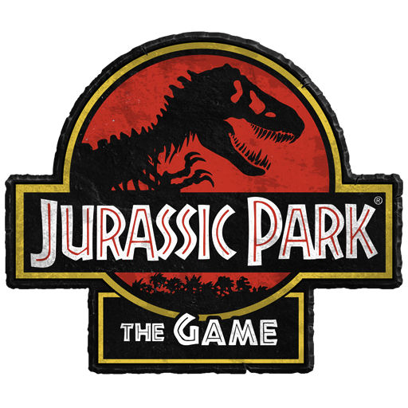
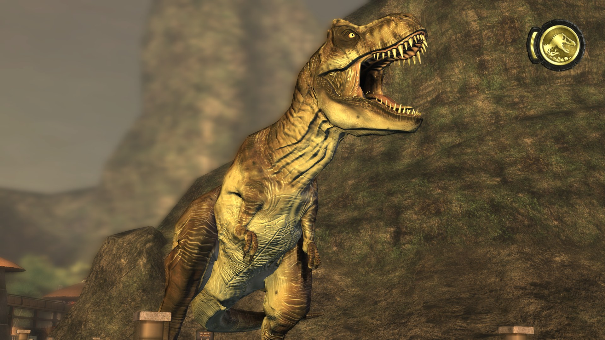

# JPTG Recomp

**JPTG Recomp** is a native Apple Silicon port of **Jurassic Park: The Game** (Telltale Games, 2011),
made by statically recompiling the original Mac release.

The original Mac version is a 32-bit Intel application, so it has not run on macOS since Catalina,
and it no longer receives updates. JPTG Recomp translates the game's own executable, function by
function, into C and compiles it for arm64. Telltale's engine and game code run unchanged, with the
same scripts, rendering and behaviour; only the parts that talked to the 2011 operating system
(window, OpenGL context, input, audio library, Steam) are replaced with native implementations.

This is an unofficial community project. It is not affiliated with or endorsed by Telltale Games,
LCG Entertainment or Universal. **You need your own copy of the game**: none of the game's code or
data files are included in this repository or in its downloads.

## Playing on macOS

  1. Make sure the Mac version of **Jurassic Park: The Game** is installed through Steam. The game is
     no longer sold, but owners can still download it from their Steam library.
  2. Download `JPTG-Recomp-macOS.dmg` from the [Releases](https://github.com/NightSightProductions/JPTG-Recomp/releases) page.
  3. Open it and run **Install JPTG Recomp**. The installer finds your copy of the game, checks that
     it is the supported release, and builds the game on your Mac. The first build takes a few
     minutes and needs an internet connection and Apple's Command Line Tools (the installer offers
     to install them).
  4. Launch **Jurassic Park: The Game** from your Applications folder.

Note: release builds are not notarized by Apple yet, so macOS blocks the installer the
first time it is opened. To allow it, go to **System Settings > Privacy & Security** and
click **Open Anyway**.

Some things worth knowing:
  - Saved games and settings are stored where the original Mac version kept them
    (`~/Library/Application Support/Telltale Games/JurassicPark100`), so existing saves carry over.
  - Steam does not need to be running. Achievements are recorded locally instead of on Steam.
  - The resolution and fullscreen options in the game's Graphics settings work as in the original;
    on Retina displays the game renders at full pixel resolution.

## How It Works

  - `tools/recomp.py` reads the original executable (a 32-bit Intel Mach-O) and translates every
    function into C that runs against a simulated 32-bit address space. The executable's symbol
    table gives the exact function boundaries and names.
  - `runtime/` is what the translated code runs on: the CPU state, memory, threads, and
    re-implementations of the 2011 system libraries the game imported (libc, the C++ runtime,
    CoreFoundation and others), with the original 32-bit data layouts.
  - Platform replacements: a Cocoa/OpenGL host (`runtime/app.m`, `runtime/gl.c`), an FMOD Ex
    replacement on CoreAudio (`runtime/fmod.c`), and an offline Steam layer (`runtime/steam.c`).
  - The build happens on your machine from your copy of the game, and the app loads the game's
    data from your Steam installation at run time.

## License

The code in this repository is licensed under the terms of the **MIT License**.
You can find the entire license in the [LICENSE](LICENSE) file.

**Jurassic Park: The Game**, its executable and its data remain the property of their respective
owners. The C code that the build generates from the game's executable (`gen/`, `gen_full/`) is
derived from the game and **must not be redistributed**; the repository is set up so that it is
never committed.

The Jurassic Park: The Game logo and screenshots are shown only to identify the game; the logo is
a trademark of its respective owners.

## Features

**JPTG Recomp** provides:
  - Native Apple Silicon (arm64) build of the original Mac release, with the original engine code
  - All four episodes, with saves and settings compatible with the original Mac version
  - Modern resolutions, Retina rendering and native macOS fullscreen
  - Audio through CoreAudio, with music, ambience and dialogue
  - Offline play with locally stored achievements
  - A macOS installer that builds the game from your own copy

## Known Issues

  - Shadows cast by characters can look blocky at high resolutions. The engine renders them into
    fixed 512×512 shadow maps; the original Mac release behaves the same way.

## Support and Feedback

  * [GitHub Issue Tracker](https://github.com/NightSightProductions/JPTG-Recomp/issues)
  * [Discord](https://discord.gg/GKacpbpyQb)

When reporting a problem, include `~/Library/Logs/jp-recomp.log` from the session where it happened.
The log is replaced every time the game starts.

## System Requirements

### Operating System

|             | macOS                          |
|-------------|--------------------------------|
| Min Version | macOS 11 Big Sur, Apple Silicon (M1 or later) |

Note: only macOS 27 has been tested so far.

Note: Intel Macs are not supported.

### Software

|                                                                       | Min Version |
|-----------------------------------------------------------------------|-------------|
| Jurassic Park: The Game, Mac version from Steam                      | -           |
| Xcode Command Line Tools   `xcode-select --install`                | 15          |
| Python 3 (included with the Command Line Tools)                       | 3.9         |

The build downloads two Python packages, [Capstone](https://www.capstone-engine.org) 5.0.9 and
[LIEF](https://lief.re) 1.0.0, into a local `.venv` folder.

## Build Instructions

  1. Clone the repository:

     `git clone https://github.com/NightSightProductions/JPTG-Recomp.git`

  2. Build the game from your copy (the default Steam location is used if no path is given):

     `scripts/build.sh "/path/to/JurassicPark100.app"`

     This verifies the game executable, translates it (`make full-gen`), compiles it
     (`make full app`) and creates `build/Jurassic Park The Game.app` (`make bundle`), using the
     game's own icon from your install.

  3. Run it:

     `open "build/Jurassic Park The Game.app"`

     or from a terminal, with the log on screen:

     `./build/JurassicPark orig.bin "/path/to/JurassicPark100.app/Contents/Resources"`

  4. To build the installer disk image, run:

     `setup/macos/build_installer.sh`

### Tests

`make && tests/run.sh` builds a small test harness from the game's embedded Lua interpreter and
zlib (`make gen` translates just that part of the executable) and checks it against recorded output.

### Debugging Options

These environment variables are read by the game when started from a terminal:

| Variable | Effect |
|----------|--------|
| `JP_STRICT=1` | Stop on any call into a system function that is not implemented, instead of logging it |
| `JP_WATCH=name,...` | Log every call to the game functions whose names contain one of the given strings |
| `JP_TRACE_FILES=1` | Log file access |
| `JP_TRACE_GL=1`, `JP_TRACE_GLARGS=glFunc,...` | Log OpenGL calls, optionally with arguments |
| `JP_TRACE_FMOD=1` | Log audio activity |

`make memcheck` builds a variant that reports writes to a chosen memory range (`JP_MC_LO`,
`JP_MC_HI`, `JP_MC_ARM`), which is useful for tracking down memory corruption.

## Acknowledgements

  * [stb_vorbis](https://github.com/nothings/stb) by Sean Barrett (public domain), for Ogg Vorbis decoding
  * [Capstone](https://www.capstone-engine.org) and [LIEF](https://lief.re), used by the translator
  * [TelltaleToolLib](https://github.com/LucasSaragosa/TelltaleToolLib) and the Telltale modding
    community, whose documentation of the engine's formats helped early in the project
